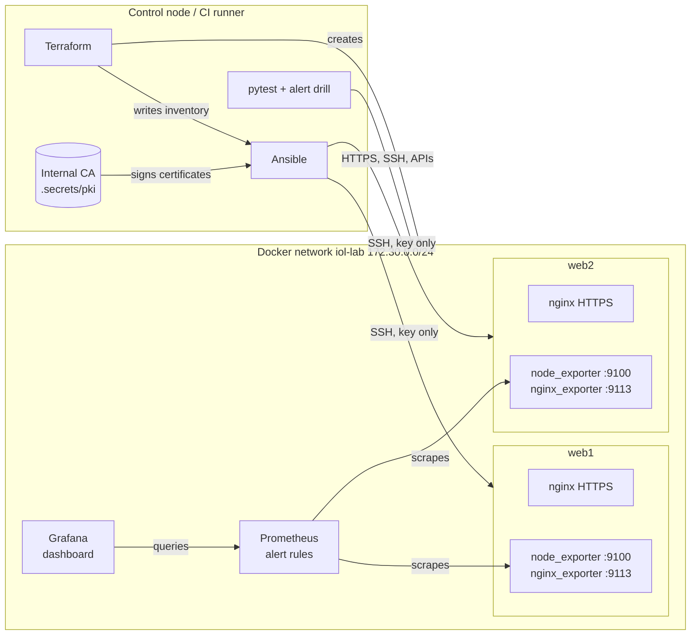

# Infra Observability Lab

[](https://github.com/ahmedbmohamed/infra-observability-lab/actions/workflows/ci.yml)

A small Linux infrastructure that builds, configures and checks itself:

- **Terraform** creates the network, two web servers, Prometheus and Grafana.
- **Ansible** hardens the servers and installs nginx over HTTPS. The certificates come from an internal CA.
- **Prometheus** collects metrics and raises alerts. **Grafana** shows them on a dashboard.
- **GitHub Actions** runs everything on each push. A test stops nginx on purpose and checks that the alert fires.

Everything runs on Docker on a single machine. It costs nothing and needs no cloud account.

## Architecture



| Step | Tool | What happens |
|---|---|---|
| 1. Provision | Terraform | Builds the server image and creates the network, `web1`, `web2`, Prometheus and Grafana. It generates the Prometheus scrape targets and the Ansible inventory from the same list of servers, so `web_count = 3` adds a server everywhere. |
| 2. Configure | Ansible | Roles `common` (packages, SSH hardening), `pki` (internal CA and one certificate per server), `node_exporter`, `nginx` (TLS site, security headers, status page, exporter). |
| 3. Check | Ansible | A second run must report `changed=0` (idempotence). |
| 4. Test | pytest | 17 tests on HTTPS, TLS versions, headers, SSH rules, Prometheus targets and rules, Grafana. |
| 5. Alert drill | Python | Stops nginx on `web1`, waits for `NginxDown` to fire, restarts nginx, waits for the alert to clear. |
| 6. Clean up | Terraform | `terraform destroy`, always, even when a step fails. |

## What the servers get

**SSH**
- Key login only (`PasswordAuthentication no`, `AuthenticationMethods publickey`).
- No root login. Only the `ops` user may log in (`AllowUsers ops`).
- `MaxAuthTries 3`, no X11 or agent forwarding.
- Ansible checks the file with `sshd -t` before it replaces the old one.

**HTTPS (nginx)**
- TLS 1.2 and 1.3 only. HTTP redirects to HTTPS.
- Certificates signed by the lab's own CA (ECDSA). The CA private key stays on the control node.
- Headers: HSTS, `X-Content-Type-Options`, `X-Frame-Options`, `Referrer-Policy`, `Content-Security-Policy`.
- `server_tokens off`: no nginx version in the responses.
- Ansible runs `nginx -t` before reloading, so a broken template never takes a server down.

**Monitoring**
- `node_exporter` (CPU, memory, disk, network) and `nginx-prometheus-exporter` (requests, connections, nginx up or down).
- Both binaries are downloaded from their GitHub releases with a pinned version and a SHA-256 check. They run as their own system users, not root.

## Alerts

Defined in [`monitoring/alerts.yml`](monitoring/alerts.yml) and unit-tested with `promtool test rules` ([`tests/alerts_test.yml`](tests/alerts_test.yml)).

| Alert | Condition | For | Severity |
|---|---|---|---|
| TargetDown | Prometheus cannot scrape a target | 1 min | critical |
| NginxDown | the exporter cannot reach nginx | 30 s | critical |
| HighCpuUsage | CPU above 85% | 5 min | warning |
| LowMemory | less than 10% memory available | 5 min | warning |
| LowDiskSpace | less than 10% free on `/` | 10 min | warning |
| NginxNoTraffic | nginx is up but gets no requests | 15 min | info |

## Run it yourself

You need Docker, Terraform 1.6 or newer, Python 3.10 or newer, and an x86_64 machine.

```bash
pip install ansible-core cryptography -r tests/requirements.txt
ansible-galaxy collection install -r ansible/requirements.yml

make up            # Terraform: create everything
make configure     # Ansible: configure the servers
make idempotence   # Ansible again: must change nothing
make test          # pytest
make drill         # stop nginx on web1 and watch the alert
make down          # destroy everything
```

Or `make all` for the whole sequence. `make help` lists the steps.

| URL | What |
|---|---|
| https://localhost:8443, https://localhost:8444 | web1, web2 (trust `.secrets/pki/ca.crt` or use `curl --cacert`) |
| http://localhost:9090 | Prometheus |
| http://localhost:3000 | Grafana, user `admin`, password from `terraform -chdir=terraform output -raw grafana_admin_password` |

The SSH key, the CA and the certificates are created in `.secrets/` on your machine. That folder is in `.gitignore` and is never committed.

## CI/CD

[`.github/workflows/ci.yml`](.github/workflows/ci.yml) has two jobs:

1. **lint**: `terraform fmt` and `validate`, `yamllint`, `ansible-lint` (production profile), `promtool check rules` and the alert unit tests.
2. **deploy-and-test**: steps 1 to 6 from the table above on a fresh GitHub runner. When a step fails, it prints the service status and logs. Screenshots and the second Ansible run are kept as artifacts.

A [`Jenkinsfile`](Jenkinsfile) runs the same `make` steps on a Jenkins agent with Docker. The pipeline that actually runs for this repository is GitHub Actions.

## Design choices and limits

- **Containers instead of VMs.** The servers are Docker containers reached over SSH, so Ansible manages them exactly like VMs and the lab runs free in CI. On real VMs, Terraform would use a cloud or Proxmox provider and the Ansible roles would stay almost the same.
- **supervisord instead of systemd.** The containers have no systemd, so supervisord starts sshd, nginx and the exporters. On a VM, the roles would install systemd units instead.
- **No host firewall.** nftables or ufw cannot be managed inside an unprivileged container. On a VM, the `common` role would add one that allows only SSH, HTTP and HTTPS.
- **No Alertmanager.** Alerts are visible in Prometheus and Grafana but are not sent anywhere (e-mail, Slack). Adding Alertmanager is the next step.
- **Terraform state is local.** For a team, it would go to a remote backend with locking.
- **x86_64 only.** The exporter downloads are the `linux-amd64` builds.

## Repository layout

```
terraform/          network, servers, Prometheus, Grafana, generated inventory
images/node/        server image: Ubuntu 24.04, sshd, supervisord, ops user
ansible/            site.yml and roles: common, pki, node_exporter, nginx
monitoring/         alert rules, Grafana datasource and dashboard
tests/              pytest suite, alert drill, promtool alert tests
.github/workflows/  CI pipeline
Jenkinsfile         same pipeline for Jenkins
```

## License

MIT. See [LICENSE](LICENSE).
