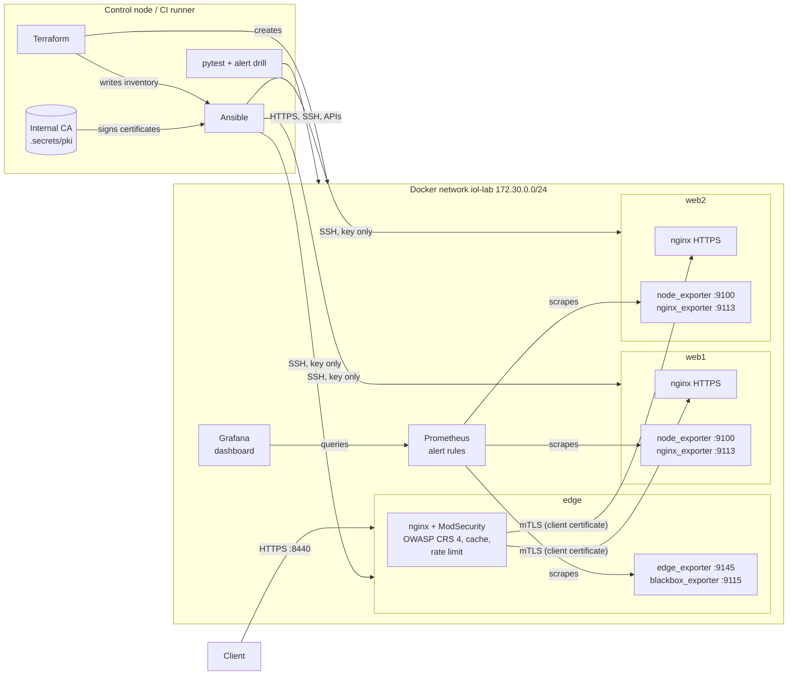
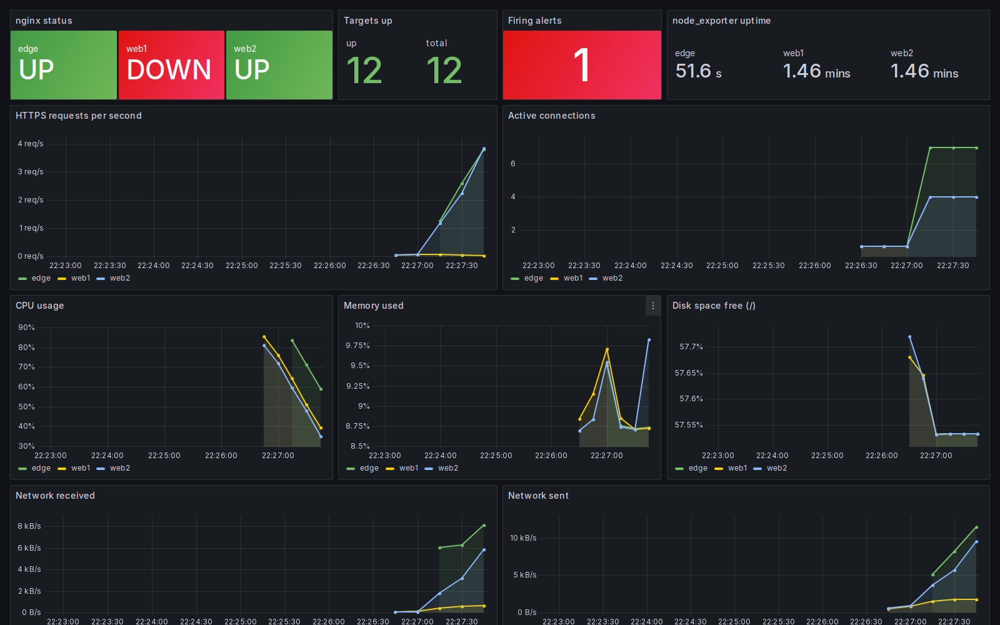
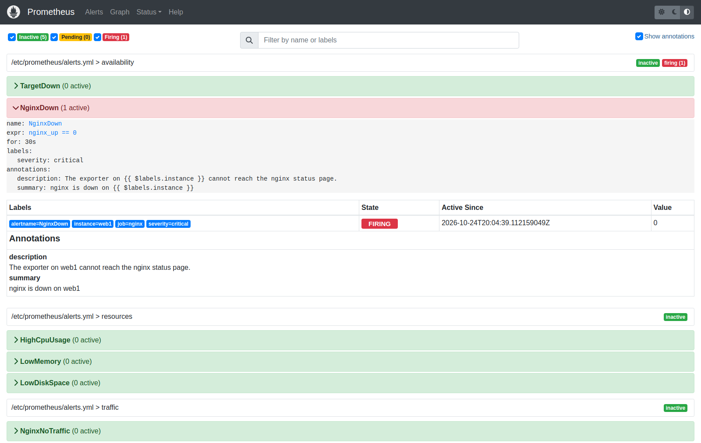
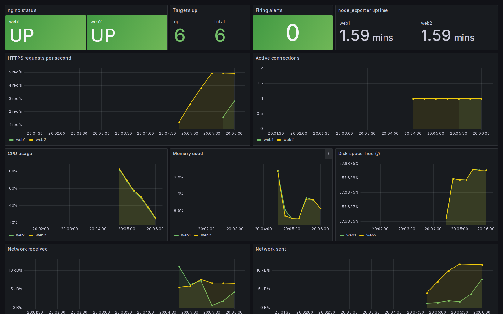

# Infra Observability Lab

[](https://github.com/ahmedbmohamed/infra-observability-lab/actions/workflows/ci.yml)

A small Linux infrastructure that builds, configures and checks itself:

- **Terraform** creates the network, two web servers, an edge server, Prometheus and Grafana.
- **Ansible** hardens the servers and installs nginx over HTTPS. The certificates come from an internal CA.
- **The edge** is the only public entry point, like a CDN/WAF: **ModSecurity with the OWASP Core Rule Set 4**
  (tuned to zero false positives on the test corpus), virtual patches, rate limiting, a cache, and
  **authenticated origin pull** (the web servers only answer to the edge's client certificate).
  Details: [docs/edge-security.md](docs/edge-security.md). The same policy for Cloudflare, in Terraform: [cloudflare/](cloudflare/README.md).
- **Prometheus** collects metrics, probes the HTTPS endpoints and certificates, and raises alerts. **Grafana** shows them.
- **GitHub Actions** runs everything on each push: tests, an outage drill, an attack drill and the GoTestWAF benchmark.

Everything runs on Docker on a single machine. It costs nothing and needs no cloud account.

## Architecture



| Step | Tool | What happens |
|---|---|---|
| 1. Provision | Terraform | Builds the server image and creates the network, `edge`, `web1`, `web2`, Prometheus and Grafana. It generates the Prometheus scrape targets, the probe targets and the Ansible inventory from the same list of servers, so `web_count = 3` adds a server everywhere (also behind the edge). |
| 2. Configure | Ansible | Roles `common` (packages, SSH hardening), `pki` (internal CA, server certificates, the edge client certificate), `node_exporter`, `nginx` (TLS site, security headers, status page, exporter), and on the edge `blackbox_exporter` and `edge` (ModSecurity, CRS, cache, rate limit, edge_exporter). |
| 3. Check | Ansible | A second run must report `changed=0` (idempotence). |
| 4. Test | pytest | 70 tests: 36 WAF cases (attacks blocked, legitimate requests allowed), origin protection, cache, rate limit, TLS policy, probes, HTTPS, SSH rules, Prometheus, Grafana. |
| 5. Outage drill | Python | Stops nginx on `web1`: `NginxDown` must fire and the edge must keep serving from `web2`. Then restarts nginx and waits for the alert to clear. |
| 6. Attack drill | Python | About 2 attacks per second while a normal user browses: `WafAttackSpike` must fire, every attack must be blocked, no legitimate request refused. |
| 7. Benchmark | GoTestWAF | Thousands of payloads from an independent tool; summary in the run page. |
| 8. Clean up | Terraform | `terraform destroy`, always, even when a step fails. |

## Screenshots

Taken by the CI during the alert drill ([`refresh-screenshots`](.github/workflows/screenshots.yml) workflow).

**nginx stopped on web1:** the dashboard shows web1 DOWN and one firing alert.



**Prometheus:** `NginxDown` firing for web1.



**After the repair:** web1 is back up and the alert has cleared.



## Edge security in short

| Feature | How | Proof |
|---|---|---|
| WAF | ModSecurity v3 + OWASP CRS 4.30, blocks at paranoia level 1, logs level 2, anomaly threshold 5 | own corpus: 24/24 attacks blocked, 12/12 tricky legitimate requests allowed (`make waf-check`) |
| Independent benchmark | GoTestWAF at levels 1 to 4 (`waf-benchmark` workflow) | level 1: 78.5% of non-encoded attacks blocked, 90.8% of legitimate texts allowed; level 2: 86.4% / 64.5% |
| Tuning | 3 exclusions, each for one rule, one field, one URL (password, review text, profile URL) | before tuning: 11/12 (level 1), 9/12 (level 2) legitimate requests allowed |
| Local rules | IP deny list, virtual patches (`/actuator`, XXE, UTF-7 XML, out-of-band callback domains), JSON-only API writes (415) | WAF tests |
| Rate limit | 10 login attempts per minute per IP, burst 5, then 429 | `test_login_is_rate_limited` |
| Origin protection | origins require the edge client certificate (mTLS), else 403 | `test_origins_refuse_requests_that_bypass_the_edge` |
| Cache | follows `Cache-Control`, never `/api/`, bypassed with credentials, compression at the edge | cache tests |
| TLS | 1.2/1.3, ECDHE + AEAD only, HSTS; the edge verifies the origin certificates | TLS tests |
| Traceability | `X-Request-ID` in the response = transaction ID in the WAF audit log | `tools/waf_report.py --request-id` |
| Monitoring | probes and certificate expiry (blackbox_exporter), WAF and cache metrics (edge_exporter), *Edge security* dashboard | alert drills |

Full write-up: [docs/edge-security.md](docs/edge-security.md). Runbooks: [WAF attack spike](docs/runbooks/waf-attack-spike.md),
[certificates](docs/runbooks/certificate-expiry.md). Client-style report: [docs/assessment-report.md](docs/assessment-report.md).

## What the servers get

**SSH**
- Key login only (`PasswordAuthentication no`, `AuthenticationMethods publickey`).
- No root login. Only the `ops` user may log in (`AllowUsers ops`).
- `MaxAuthTries 3`, no X11 or agent forwarding.
- Ansible checks the file with `sshd -t` before it replaces the old one.

**HTTPS (nginx)**
- TLS 1.2 and 1.3 only. HTTP redirects to HTTPS.
- Certificates signed by the lab's own CA (ECDSA). The CA private key stays on the control node.
- Headers: HSTS, `X-Content-Type-Options`, `X-Frame-Options`, `Referrer-Policy`, `Content-Security-Policy`.
- `server_tokens off`: no nginx version in the responses.
- Ansible runs `nginx -t` before reloading, so a broken template never takes a server down.

**Monitoring**
- `node_exporter` (CPU, memory, disk, network) and `nginx-prometheus-exporter` (requests, connections, nginx up or down).
- The filesystem collector is told to keep `overlay` filesystems, because `/` is one inside a container.
- Both binaries are downloaded from their GitHub releases with a pinned version and a SHA-256 check. They run as their own system users, not root.

## Alerts

Defined in [`monitoring/alerts.yml`](monitoring/alerts.yml) and unit-tested with `promtool test rules` ([`tests/alerts_test.yml`](tests/alerts_test.yml)).

| Alert | Condition | For | Severity |
|---|---|---|---|
| TargetDown | Prometheus cannot scrape a target | 1 min | critical |
| NginxDown | the exporter cannot reach nginx | 30 s | critical |
| HighCpuUsage | CPU above 85% | 5 min | warning |
| LowMemory | less than 10% memory available | 5 min | warning |
| LowDiskSpace | less than 10% free on `/` | 10 min | warning |
| NginxNoTraffic | nginx is up but gets no requests | 15 min | info |
| EndpointProbeFailed | an HTTPS probe fails (down, bad status, untrusted certificate) | 1 min | critical |
| CertificateExpiringSoon | a certificate expires in less than 21 days | 10 min | warning |
| CertificateExpiryCritical | a certificate expires in less than 7 days | 10 min | critical |
| WafAttackSpike | the WAF blocks more than 30 requests per minute | 30 s | warning |
| EdgeHighErrorRate | more than 5% of the edge responses are 5xx | 5 min | critical |

## Run it yourself

You need Docker, Terraform 1.6 or newer, Python 3.10 or newer, and an x86_64 machine.

```bash
pip install ansible-core cryptography -r tests/requirements.txt
ansible-galaxy collection install -r ansible/requirements.yml

make up            # Terraform: create everything
make configure     # Ansible: configure the servers
make idempotence   # Ansible again: must change nothing
make test          # pytest
make drill         # stop nginx on web1 and watch the alert
make waf-check     # attack and legitimate corpus against the edge, as a table
make waf-drill     # attack campaign: WafAttackSpike must fire
make gotestwaf     # independent benchmark (needs Go)
make down          # destroy everything
```

Or `make all` for the whole sequence. `make help` lists the steps.

| URL | What |
|---|---|
| https://localhost:8440 | the site, through the edge (trust `.secrets/pki/ca.crt` or use `curl --cacert`) |
| https://localhost:8443, https://localhost:8444 | web1, web2 directly: 403 without the edge client certificate (only `/healthz` is open) |
| http://localhost:9090 | Prometheus |
| http://localhost:3000 | Grafana, user `admin`, password from `terraform -chdir=terraform output -raw grafana_admin_password` |

The SSH key, the CA and the certificates are created in `.secrets/` on your machine. That folder is in `.gitignore` and is never committed.

## CI/CD

[`.github/workflows/ci.yml`](.github/workflows/ci.yml) has two jobs:

1. **lint**: `terraform fmt` and `validate` (lab and Cloudflare), `yamllint`, `ansible-lint` (production profile), `promtool check rules` and the alert unit tests.
2. **deploy-and-test**: steps 1 to 8 from the table above on a fresh GitHub runner. When a step fails, its last lines go into an error annotation and the service status and logs are printed. Screenshots, the GoTestWAF reports and the second Ansible run are kept as artifacts.

A [`Jenkinsfile`](Jenkinsfile) runs the same `make` steps on a Jenkins agent with Docker. The pipeline that actually runs for this repository is GitHub Actions.

## Design choices and limits

- **Containers instead of VMs.** The servers are Docker containers reached over SSH, so Ansible manages them exactly like VMs and the lab runs free in CI. On real VMs, Terraform would use a cloud or Proxmox provider and the Ansible roles would stay almost the same.
- **supervisord instead of systemd.** The containers have no systemd, so supervisord starts sshd, nginx and the exporters. On a VM, the roles would install systemd units instead.
- **No host firewall.** nftables or ufw cannot be managed inside an unprivileged container. On a VM, the `common` role would add one that allows only SSH, HTTP and HTTPS.
- **No Alertmanager.** Alerts are visible in Prometheus and Grafana but are not sent anywhere (e-mail, Slack). Adding Alertmanager is the next step.
- **Terraform state is local.** For a team, it would go to a remote backend with locking.
- **x86_64 only.** The exporter downloads are the `linux-amd64` builds.

## Repository layout

```
terraform/          network, servers, edge, Prometheus, Grafana, generated inventory
cloudflare/         the edge policy for Cloudflare (Terraform, provider v5)
images/node/        server image: Ubuntu 24.04, sshd, supervisord, ops user
ansible/            site.yml and roles: common, pki, node_exporter, nginx, blackbox_exporter, edge
monitoring/         alert rules, Grafana datasource and dashboards
tests/              pytest suite, WAF corpus, outage and attack drills, promtool alert tests
tools/              WAF audit log report, GoTestWAF runner and summary, CI helper
docs/               edge security write-up, assessment report, runbooks, screenshots
.github/workflows/  CI pipeline
Jenkinsfile         same pipeline for Jenkins
```

## License

MIT. See [LICENSE](LICENSE).
