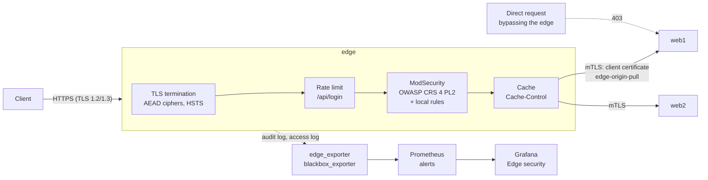

# Edge security: WAF, certificates, cache and origin protection

The edge is a reverse proxy in front of the web servers. It is the only public entry point and it does what a
CDN/WAF such as Cloudflare or Akamai does for a customer: TLS termination, web application firewall, rate
limiting, caching, and protection of the origin servers. Everything is built from open source parts, so the
whole setup can be tested in CI on every push.

## 1. Request path

| Order | Check | Answer when it fails | File |
|---|---|---|---|
| 1 | TLS: 1.2 or 1.3, forward secrecy, AEAD ciphers only (no CBC) | handshake refused | `edge-site.conf.j2` |
| 2 | Rate limit on `/api/login`: 10 per minute per IP, burst 5 | 429 | `edge-site.conf.j2` |
| 3 | IP deny list (rule 10001) | 403 | `custom-rules.conf.j2` |
| 4 | Virtual patch: `/actuator`, `/jolokia`, `/manager/html`... (10010) | 403 | `custom-rules.conf.j2` |
| 5 | API contract: write requests to `/api/` must be JSON (10020, 10021) | 415 | `custom-rules.conf.j2` |
| 6 | OWASP CRS 4.30, paranoia level 2, anomaly threshold 5 | 403 | `crs-setup.conf.j2` |
| 7 | Cache: only what the origin marks cacheable, never with credentials | - | `edge-site.conf.j2` |
| 8 | Origin: the edge proves who it is with a client certificate | 403 at the origin | `lab-site.conf.j2` |

Every response carries an `X-Request-ID`. The same ID is the transaction ID in the WAF audit log, so a
blocked customer can quote it and support finds the exact rules that matched
(`tools/waf_report.py --request-id`).

## 2. WAF: how it decides

The CRS uses **anomaly scoring**. Each rule that matches adds points (critical = 5, error = 4, warning = 3)
and lets the request continue. At the end, rule 949110 blocks if the total reaches the threshold (5). One
critical match blocks; two weak signals also block. This is why one rule can be removed for one field without
opening a hole: the other rules still score.

**Paranoia level 2** adds stricter rules on top of level 1 (more SQL and command injection patterns,
off-domain URLs...). It catches more evasions but gives more false positives, so it needs tuning.

## 3. Tuning: from 3 false positives to 0

`tests/waf_corpus.py` holds 21 attacks and 12 legitimate requests that look suspicious (a strong password,
an apostrophe in a name, "select the best laptop", a review with `;` and `--`, a link in a profile). Results
measured on the lab:

| Configuration | Attacks blocked | Legitimate requests allowed |
|---|---|---|
| CRS paranoia level 1, no tuning | 21/21 | 11/12 |
| CRS paranoia level 2, no tuning | 21/21 | **9/12** |
| CRS paranoia level 2 + 3 exclusions (current) | 21/21 | **12/12** |

The three false positives and their fixes (`exclusions-before-crs.conf.j2`):

| Request | Rules that matched | Fix, smallest possible scope |
|---|---|---|
| `POST /api/login` with password `Tr0ub4dor&3';--Horse!` | 942540, 942180, 942440 (SQL) | Remove SQL injection rules for `json.password` on `/api/login` only. A password is hashed, never put in a query. The username is still inspected. |
| `POST /api/comments` "I'd buy it again; 5/5 -- Sam" | 932200 (RCE bypass), 942440 (SQL comment) | Remove those 2 rules for `json.text` on `/api/comments` only. XSS and other rules still apply. |
| `POST /api/profile` with `website: https://example.com/...` | 931130 (off-domain URL, RFI) | Remove that rule for `json.website` on `/api/profile` only. |

Rules followed: one rule (or one rule family), one parameter, one URL. Never turn a rule off everywhere and
never lower the paranoia level of the whole site for one form field. The test suite runs the attack cases
after each change, so an exclusion that opens a hole fails the CI.

A lesson from building the tests: a test endpoint called `/api/whoami` was blocked by three RCE rules,
because `whoami` is a Unix command. Paths and parameter names are inspected too.

GoTestWAF (Wallarm's open-source benchmark) runs in CI as an independent check with a few thousand
payloads, encodings and placements: see `reports/gotestwaf-summary.md` in the CI artifacts and
[the assessment report](assessment-report.md).

## 4. Cache

- The origin decides: pages and static files are sent with `Cache-Control: max-age=60`, the API with
  `no-cache`. The edge also never caches `/api/`.
- Requests with an `Authorization` header or a session cookie bypass the cache (`X-Cache-Status: BYPASS`):
  a personal page must never be stored in a shared cache.
- If every origin fails, the edge serves the last good copy (`proxy_cache_use_stale`).
- **Bug found and fixed:** at first the edge cached the origin's gzip-compressed response and served it to
  clients that had not asked for gzip. Now the edge asks the origin for an uncompressed body
  (`Accept-Encoding: ""`) and compresses itself, with `Vary: Accept-Encoding`. A test checks both cases.

## 5. Origin protection

A WAF is useless if attackers can reach the origin directly. The origins ask for a client certificate
(`ssl_verify_client optional`) and answer 403 unless it is valid, issued by the lab CA, and has the CN
`edge-origin-pull`. This is what Cloudflare calls *Authenticated Origin Pulls* (Akamai: *mTLS origin
keystore*, or *Site Shield* for an IP-based allow list). The edge also verifies the origin certificate
(`proxy_ssl_verify`, name `origin.lab`), the equivalent of Cloudflare's *Full (strict)* mode.

The `/healthz` page stays open, for monitoring.

## 6. Monitoring

| Signal | Source | Alert |
|---|---|---|
| HTTPS probe of the edge and of each origin, certificate expiry | blackbox_exporter on the edge | `EndpointProbeFailed`, `CertificateExpiringSoon` (21 days), `CertificateExpiryCritical` (7 days) |
| Blocked requests, by attack type | `edge_exporter` reading the ModSecurity JSON audit log | `WafAttackSpike` (> 0.5/s for 30 s) |
| Responses by status class and cache status | `edge_exporter` reading the JSON access log | `EdgeHighErrorRate` (> 5% of 5xx for 5 min) |

`edge_exporter.py` is a small exporter written for this lab (Python standard library only). Its labels are
bounded (status class, cache status, CRS attack tag) so the number of time series stays small.

The alert rules have unit tests (`tests/alerts_test.yml`, run by `promtool`), and two drills run in CI:

- **Origin outage** (`tests/alert_drill.py`): nginx stops on web1, `NginxDown` fires, and the edge keeps
  serving the site from web2 during the outage, then sends traffic to web1 again.
- **Attack campaign** (`tests/waf_drill.py`): about 2 malicious requests per second with 18 payload types
  while a normal user keeps browsing. Measured on the lab: `WafAttackSpike` fired 51 s after the first
  attack, 124/124 attacks were blocked, no legitimate request was refused, and the alert cleared 51 s after
  the attack stopped.

Runbooks: [WAF attack spike](runbooks/waf-attack-spike.md), [certificates](runbooks/certificate-expiry.md).

## 7. Same ideas on Cloudflare and Akamai

| Lab | Cloudflare | Akamai |
|---|---|---|
| OWASP CRS, anomaly scoring, paranoia level | OWASP Core Ruleset (score threshold, paranoia level) + Cloudflare Managed Ruleset | App & API Protector (Adaptive Security Engine, attack groups) |
| Local rules (deny list, virtual patch, API contract) | WAF custom rules | Custom rules, network lists |
| Exclusions for one field on one URL | Managed rule exceptions / overrides | Rule exceptions in the security policy |
| `limit_req` → 429 | Rate limiting rules | Rate controls |
| Client certificate to the origin | Authenticated Origin Pulls | mTLS origin keystore, Site Shield |
| Internal CA, certificate expiry alerts | Origin CA, edge certificate notifications | Certificate Provisioning System (CPS) |
| `proxy_cache` + `Cache-Control` | Cache rules | Caching behavior in Property Manager |

The Cloudflare version of this policy is written in Terraform in [`cloudflare/`](../cloudflare/README.md).

## 8. Limits (said openly)

- ModSecurity v3 + CRS is what many managed WAFs started from, but it is not Cloudflare's or Akamai's engine:
  no machine-learning attack score, no bot management, no IP reputation, no DDoS protection.
- The rate limit is per IP on a single edge. Behind a NAT, many users share one IP; several edges would need a
  shared counter.
- The attack corpus was written while building the lab, so it is not independent. GoTestWAF is the
  independent measure.
- Response bodies are inspected only up to 512 KB, and the audit log does not keep request bodies (they may
  hold passwords): an investigation sees the matched value, not the whole body.
- One edge is a single point of failure. In production there would be at least two, behind anycast or a
  load balancer.
